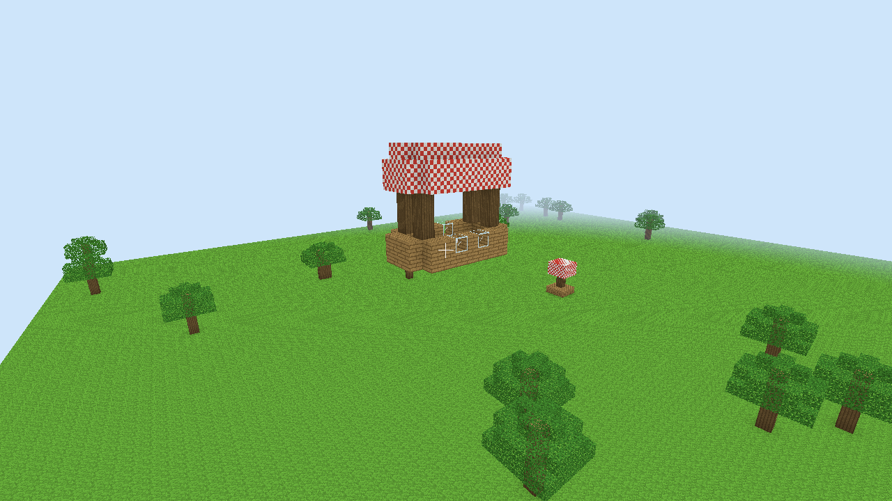
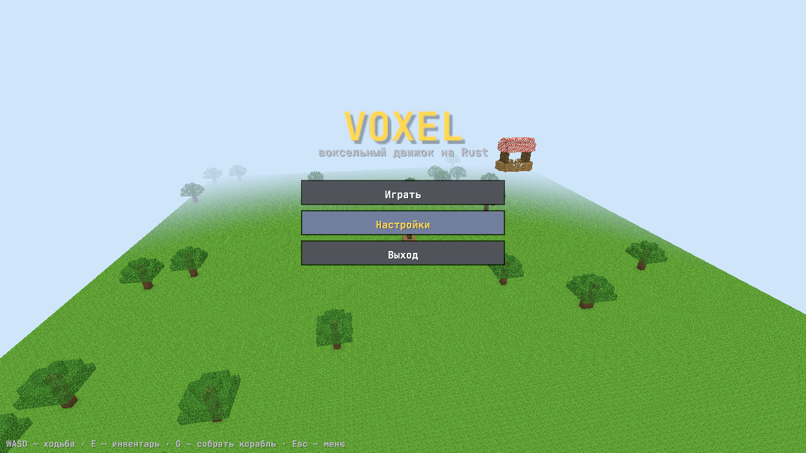
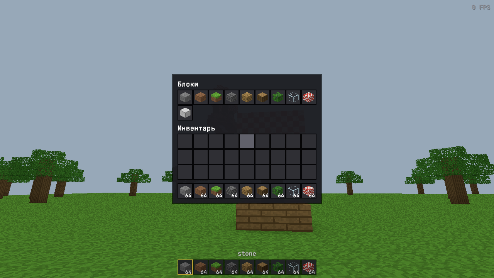

# Voxel — минималистичный воксельный движок на Rust

Мир из блоков в духе Minecraft: чанки 16×16×16, ограниченный плоский мир и физика
конструкций по мотивам **Create Aeronautics / Sable**. Любую постройку можно «собрать»
в отдельное физическое тело: оно падает, сталкивается, крутится, летает на воздушных шарах,
а по нему можно ходить и достраивать его прямо в полёте.



| Главное меню | Инвентарь |
|---|---|
|  |  |

## Запуск

```bash
cd VoxelEngine
cargo run --release
```

Скриншот без игры: `cargo run --release -- --screenshot shot.png --frames 120 --screen inventory`
(экраны: `menu`, `game`, `inventory`, `pause`, `settings`). Тесты: `cargo test --workspace`.

## Платформы

Windows, macOS и Linux (X11 и Wayland). Всё написано на чистом Rust без системных
зависимостей: окно — `winit`, графика — `wgpu` (DirectX 12 / Metal / Vulkan / OpenGL —
выбирается сам), шрифт растеризуется `fontdue` из файла в `assets/fonts`, клавиши
читаются по физическим кодам, поэтому WASD работает при любой раскладке.

CI (`.github/workflows/voxel.yml`) на каждый push собирает и тестирует движок на всех
трёх ОС и выкладывает готовые архивы (программа + `assets`) во вкладке **Actions →
артефакты**. Программа ищет `assets` рядом с собой, поэтому архив можно просто распаковать и запустить.
На Linux для запуска нужен драйвер Vulkan или OpenGL (Mesa есть почти везде).

## Управление

| Клавиша | Действие |
|---|---|
| Esc | пауза / назад |
| E | инвентарь |
| F3 | отладочная информация |
| WASD, мышь | ходьба, обзор |
| Space / Ctrl | прыжок / бег |
| V | полёт (Space — вверх, Shift — вниз) |
| ЛКМ / ПКМ | сломать / поставить блок |
| 1–9, колесо | выбор слота панели |
| **G** | собрать постройку в корабль / вписать корабль обратно в мир |
| R или СКМ (зажать) | толкать корабль, на который смотрите |
| F2 | скриншот |

В инвентаре: ЛКМ — взять/положить/поменять стопку, ПКМ — взять половину или положить
один блок; клик по палитре блоков даёт стопку (с предметом в руке — выбрасывает его).
В настройках — чувствительность мыши, угол обзора, масштаб интерфейса, творческий режим
(без него блоки тратятся при установке и попадают в инвентарь при ломании).

**Попробуйте:** нажмите «Играть» — перед вами на земле плот с шарами — наведитесь на него и нажмите **G**,
он взлетит. Над миром висит дирижабль: включите полёт (V), сядьте на палубу и выключите
полёт — вы будете стоять на летящем корабле. Сломайте пару шаров, и он начнёт снижаться.

## Архитектура

Главная идея — **всё является сеткой блоков (`Grid`) со своей позой в мире.**
Основной мир — сетка на неподвижном теле, каждый корабль — такая же сетка на
динамическом теле (это и есть «саб-уровни» Sable). Чанки, меши, рендер, лучи
и редактирование работают с любой сеткой одинаково, поэтому новые механики
сразу работают и на земле, и на кораблях.

```
crates/
  vx_core     данные: Registry (блоки), Chunk 16³, Grid, Level, assembly   ← без графики и физики
  vx_gen      генерация: Terrain (по чанкам) + Structure (из файлов)
  vx_mesh     меш чанка: отсечение скрытых граней + ambient occlusion       ← без GPU
  vx_physics  rapier3d: тело на сетку, коллайдер на чанк, масса, подъёмная сила, персонаж
  vx_ui       интерфейс: меню, HUD, инвентарь, настройки               ← без GPU и без окна
  vx_render   wgpu: массив текстур, матрица на сетку, линии, туман, бэкенд интерфейса
  vx_game     окно, ввод, игрок, инструменты — склеивает модули
assets/
  blocks.toml          реестр блоков
  world.toml           размер мира, рельеф, структуры, физика, спавн
  structures/*.toml    шаблоны структур
  textures/*.png       текстуры 16×16
  fonts/ui.ttf         шрифт интерфейса (можно заменить любым TTF/OTF)
```

Зависимости идут строго сверху вниз: `vx_core` ни от чего не зависит, остальные
зависят от него, и только `vx_game` знает обо всех. Поэтому любой модуль можно
заменить (другой рендер, другая физика, сервер без графики) без правки остальных.

Поток данных за кадр:

1. `Game::update` — ввод → персонаж → шаги физики (60 Гц) → позы сеток обновляются.
2. Правки блоков помечают чанки «грязными» (`Grid::set`).
3. `Game::sync` — для грязных чанков перестраиваются коллайдер (`vx_physics`)
   и меш (`vx_mesh`), меши уходят в рендер.
4. `Renderer::render` — каждая сетка рисуется со своей матрицей позы.

## Интерфейс (`vx_ui`)

Интерфейс разделён на три слоя, чтобы способ отрисовки можно было выбрать позже:

```
модель (vx_core::inventory, Settings)
   ↓
экраны (vx_ui::screens) — пишутся на маленьком API Ui: button, slider, toggle, slot, block_icon…
   ↓  DrawList: Rect / Quad (с текстурой) / Text — весь контракт с бэкендом
бэкенд — сейчас vx_render (wgpu) через tessellate() → треугольники
```

* `vx_ui` не знает ни про окно, ни про GPU: на вход `UiInput` (мышь, клавиши `UiKey`,
  размер экрана), на выход `DrawList` и список `Action` (например, `Quit`).
  Поэтому экраны тестируются без окна: тесты «нажимают» кнопки и перетаскивают блоки.
* **Новый экран**: вариант в `Screen`, функция в `screens/` и строка в `Gui::frame`.
* **Новый виджет**: метод у `Ui`, рисующий примитивы в `ui.draw`.
* **Стиль**: цвета и размеры в `Theme`.
* **Другая отрисовка** (egui, iced, macroquad, свой рендер): либо рисовать `DrawList`
  средствами новой библиотеки (это ~50 строк: прямоугольник, четырёхугольник, текст),
  либо, если библиотека со своими виджетами, заменить слой экранов — модель и игра
  останутся прежними. Бэкенду на wgpu/OpenGL достаточно нарисовать треугольники из
  `tessellate()` с двумя текстурами: атласом шрифта и массивом текстур блоков.

## Как расширять

### Новый блок и текстура
Положите `assets/textures/copper.png` (16×16) и добавьте в `blocks.toml`:
```toml
[[block]]
name = "copper"
density = 3.0
```
Код менять не нужно. Разные грани: `top`, `bottom`, `side`. Прозрачность: `opaque = false`
(прозрачные пиксели PNG вырезаются). Отсутствующая текстура рисуется розовой шахматкой.

Имя в интерфейсе задаётся полем `title = "Медь"` (готово к локализации).

### Своё свойство блока
Любые поля в `[block.props]` доступны из кода через `reg.get(id).props`:
```toml
[[block]]
name = "thruster"
[block.props]
thrust = 200.0
```
Так уже сделан `unbreakable` у бедрока. Например, двигатель — это ~10 строк в
`Physics::step`: собрать блоки с `thrust` и приложить силу по их направлению, как это
сделано для `lift`.

### Генерация мира
* Размер мира, слои рельефа, структуры — `assets/world.toml`.
* **Новый тип рельефа**: реализуйте трейт `Terrain` (одна функция — заполнить чанк по
  координате) и добавьте строку в `terrain_from_config` (`crates/vx_gen/src/lib.rs`).
  Параметры придут из таблицы `[terrain]`.

### Структуры
Файл `assets/structures/<имя>.toml` — слои снизу вверх, строки по Z, символы по X:
```toml
anchor = [1, 0, 1]
palette = { P = "planks", B = "balloon" }
layers = [
  ["PPP", "PPP", "PPP"],
  ["BBB", "BBB", "BBB"],
]
```
Размещение в `world.toml`: `[[structure]] name = "..."` плюс `at = [x, y, z]`
или `count = N` (случайно по поверхности). `dynamic = true` — структура появится
отдельным физическим телом.

### Физика конструкций
* Масса тела = сумма `density` блоков, центр масс и инерция считаются rapier.
* `lift` — подъёмная сила; суммарная сила приложена в «центре подъёма», поэтому
  корабль с шарами наверху сам выравнивается, а перекошенный — кренится.
  Сила ослабевает к `air_ceiling`, так что каждый корабль находит свою высоту.
* `vx_core::assembly` — сборка (связная группа не-`terrain` блоков → новая сетка)
  и разборка (поворот к ближайшей из 24 ориентаций и вписывание в мир).

## Куда развивать

* **Двигатели, пропеллеры, рули** — через `props` и силы в `Physics::step`.
* **Подшипники и шарниры** (как в Create) — joint'ы rapier между телами двух сеток;
  каждая сетка уже является отдельным телом.
* **Ориентация блоков** (направление двигателя) — добавить состояние блока в `Chunk`.
* **Бесконечный мир** — генерация уже идёт по чанкам; нужна подгрузка вокруг игрока.
* **Жадный мешинг, палитры в чанках, многопоточный мешинг** — оптимизации внутри
  `vx_mesh` и `Chunk`, интерфейсы не меняются.
* **Сохранение мира, сеть** — `Level` хранит всё состояние в одном месте.
